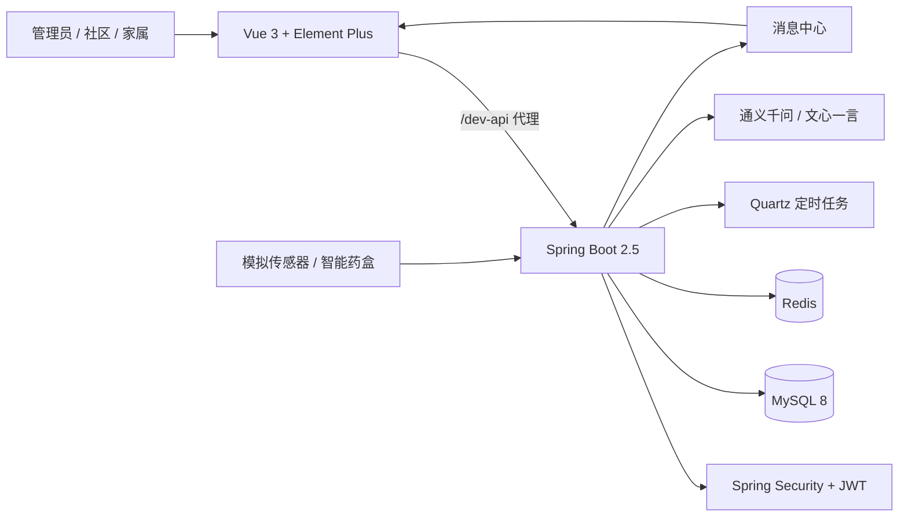
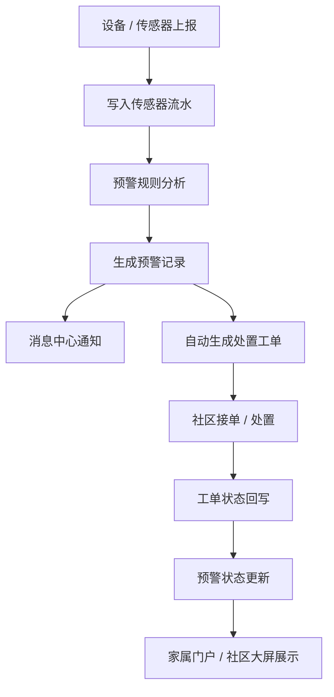

# 智慧养老大数据分析决策系统（SmartCare）

> 面向社区居家养老场景的「设备感知 → 异常预警 → 工单处置 → 家属协同」一体化平台。


---

## 项目简介

SmartCare 基于 RuoYi-Vue 二次开发，围绕「社区监管 + 家属照护」两个核心场景，打通老人档案、设备接入、传感器数据、预警规则、处置工单、随访、健康报告、服药管理、消息中心和社区大屏等业务模块。

系统支持 **管理员 / 社区 / 家属** 三类角色，家属只能查看本人已绑定老人的数据；预警可自动生成工单，工单处置结果会回写预警状态，形成业务闭环。

项目适合作为：

- Java 全栈 / 后端开发学习项目
- 课程设计、毕业设计、实训项目
- 智慧养老、社区治理、IoT 数据看板类项目原型
- RuoYi-Vue 二次开发参考

## 功能概览

| 模块 | 主要能力 |
| --- | --- |
| 老人档案 | 基础信息、健康状态、纳管状态、责任人、随访计划 |
| 家属关联 | 老人-家属绑定、亲属关系、紧急联系人、数据权限隔离 |
| 设备台账 | 设备编号、类型、绑定老人、安装时间、启停状态 |
| 传感器流水 | 心率、呼吸、离床、门磁、烟雾、药盒等模拟数据上报 |
| 预警规则 | 按设备类型、指标、阈值、持续时间配置预警等级 |
| 异常预警 | 三级预警、预警记录、预警与工单双向跳转 |
| 处置工单 | 待接单、处理中、已结办，工单状态回写预警状态 |
| 随访记录 | 例行巡访、健康随访、送药记录、服务留痕 |
| 健康报告 | 睡眠/活力评分、风险判断、AI 评估结论、日报/周报 |
| 服药管理 | 服药计划、服药执行、待服/已服/漏服、药盒状态联动 |
| 消息中心 | 预警、工单、状态变更消息，已读/未读，消息跳转 |
| 社区总览 | 在管老人、在线设备、今日预警、待办工单、随访统计 |
| 社区大屏 | 活动热力图、生命体征曲线、预警趋势、高风险排行 |
| 家属门户 | 实时状态、健康趋势、今日服药、紧急联系人、SOS |
| AI 健康评估 | 通义千问 / 文心一言生成健康评估、饮食与随访建议 |
| 系统管理 | 用户、角色、菜单、部门、字典、日志、定时任务 |

## 技术栈

| 层次 | 技术 |
| --- | --- |
| 后端 | Java 8、Spring Boot 2.5.15、Spring Security、MyBatis、Druid |
| 数据库 | MySQL 8.x |
| 缓存 / 调度 | Redis（Windows 可用 Memurai）、Quartz |
| 前端 | Vue 3.5、Vite 6、Element Plus 2.13、Pinia、Vue Router、Axios |
| 可视化 | ECharts 5.6 |
| AI | 通义千问（DashScope OpenAI 兼容接口）、百度千帆文心一言 |
| 权限 | RuoYi 角色 / 菜单 / 按钮权限体系 |
| 接口文档 | Swagger |

## 系统架构



## 核心业务闭环



### 三条重点链路

1. **预警闭环**：传感器上报 → 规则识别 → 预警生成 → 消息通知 → 自动派单 → 工单处置 → 状态回写。
2. **SOS 闭环**：家属发起 SOS → 紧急预警 → 自动工单 → 社区处置 → 状态回写。
3. **服药闭环**：服药计划 → 药盒上报 `taken / waiting / missed` → 服药执行记录 → 漏服预警 → 消息/工单跟进。

## 项目结构

```text
smart-care/
├── smart-care-backend/                 # Spring Boot 后端（RuoYi 3.9.1）
│   ├── ruoyi-admin/                    # 启动模块、SmartCare Controller
│   ├── ruoyi-system/                   # SmartCare Service / Mapper / Domain
│   ├── ruoyi-framework/                # 安全、数据源、Web 配置
│   ├── ruoyi-quartz/                   # 定时任务（预警分析）
│   ├── docs/                           # 技术文档、演示账号、PPT 提纲
│   └── sql/                            # 数据库脚本
├── smart-care-frontend/                # Vue 3 + Vite 前端
│   ├── src/api/care/                   # 养老业务 API
│   ├── src/api/iot/                    # IoT API
│   ├── src/views/care/                 # 养老业务页面
│   └── src/views/iot/                  # 设备 / 传感器页面
├── README.md
└── .gitignore
```

## 快速开始

### 1. 环境要求

- JDK 8
- Maven 3.8+
- MySQL 8.x
- Redis 6+（Windows 可使用 Memurai）
- Node.js 18+ / 20+
- npm 9+

### 2. 初始化数据库

```bash
mysql -uroot -p -e "CREATE DATABASE IF NOT EXISTS \`smart-care\` DEFAULT CHARACTER SET utf8mb4 COLLATE utf8mb4_general_ci;"
mysql -uroot -p smart-care < smart-care-backend/sql/smart-care.sql
```

> 如果使用 Navicat，直接新建 `smart-care` 数据库后运行 `smart-care-backend/sql/smart-care.sql` 即可。

### 3. 配置环境变量

后端默认读取以下环境变量，未设置时使用括号内默认值：

| 变量 | 默认值 | 说明 |
| --- | --- | --- |
| `MYSQL_HOST` | `localhost` | MySQL 地址 |
| `MYSQL_PORT` | `3306` | MySQL 端口 |
| `MYSQL_USERNAME` | `root` | MySQL 用户名 |
| `MYSQL_PASSWORD` | `123456` | MySQL 密码 |
| `TOKEN_SECRET` | `abcdefghijklmnopqrstuvwxyz` | JWT 密钥，生产环境必须修改 |
| `RUOYI_PROFILE` | `D:/ruoyi/uploadPath` | 上传文件目录 |
| `DRUID_USERNAME` | `ruoyi` | Druid 控制台用户名 |
| `DRUID_PASSWORD` | `123456` | Druid 控制台密码 |
| `SMARTCARE_AI_ENABLED` | `true` | 是否启用 AI 健康评估 |
| `QWEN_API_KEY` | 空 | 通义千问 API Key |
| `QIANFAN_API_KEY` | 空 | 百度千帆 API Key |

PowerShell 示例：

```powershell
$env:MYSQL_PASSWORD="your-mysql-password"
$env:TOKEN_SECRET="change-me-to-a-long-random-string"
$env:QWEN_API_KEY="sk-your-qwen-key"
$env:QIANFAN_API_KEY="your-qianfan-key"
```

> 仓库不包含真实 API Key、生产数据库密码。没有 AI Key 时，可将 `SMARTCARE_AI_ENABLED` 设为 `false`，或在 AI 页面按提示配置后再使用。

### 4. 启动后端

```bash
cd smart-care-backend
mvn clean package -DskipTests
java -jar ruoyi-admin/target/ruoyi-admin.jar
```

后端默认地址：`http://localhost:8888`

### 5. 启动前端

```bash
cd smart-care-frontend
npm install --registry=https://registry.npmmirror.com
npm run dev
```

前端默认地址：`http://localhost:8080`

开发环境通过 Vite 将 `/dev-api` 代理到 `http://localhost:8888`；如后端端口不同，修改 `smart-care-frontend/vite.config.js` 中的 `baseUrl`。

### 6. 访问系统

- 前端：`http://localhost:8080`
- 后端：`http://localhost:8888`
- 接口文档：`http://localhost:8888/swagger-ui/index.html`

## 演示账号

> 以下账号仅用于本地演示，部署到公网前请修改密码或删除演示账号。

| 角色 | 账号 | 密码 | 说明 |
| --- | --- | --- | --- |
| 管理员 | `SuperAdmin` | `123456` | 智慧养老全量菜单 |
| 家属 | `zhaosi` | `123456` | 绑定老人「张三」 |
| 家属 | `liumin` | `123456` | 绑定老人「李秀兰」 |
| 家属 | `wanglei` | `123456` | 绑定老人「王建国」 |
| 社区 | 需分配 `smartcare_community` 角色 | — | 社区总览、预警、工单、随访 |
| 默认管理员 | `admin` | 以数据库为准 | 若依默认管理员 |

角色与权限说明见 [`smart-care-backend/docs/演示账号说明文档.md`](smart-care-backend/docs/演示账号说明文档.md)。

## 核心实现说明

### 1. 权限与数据隔离

- 基于 RuoYi 的 `sys_role`、`sys_menu`、`sys_role_menu` 实现菜单/按钮级权限。
- 家属端按 `biz_elderly_family` 中的「家属-老人」绑定关系过滤数据，避免越权查看。
- 社区端按社区/辖区维度预留数据范围扩展点。

### 2. 预警与工单

- `biz_alert_rule` 配置设备类型、指标、比较条件、阈值、持续时间和预警等级。
- `biz_alert_record` 记录预警，`biz_work_order` 记录处置工单。
- 工单状态变更时回写预警处理状态，实现预警与工单双向追踪。
- `ruoyi-quartz` 中的 `AlertAnalysisTask` 负责定时分析传感器流水并生成预警。

### 3. IoT 数据模拟

- `iot_device` 维护设备台账，`iot_sensor_log` 记录传感器流水。
- 支持单条/批量模拟上报，便于在没有真实硬件时演示完整链路。
- 设备类型包括智能床垫、门磁、药盒、红外/雷达、烟雾/燃气等。

### 4. AI 健康评估

- `AiCareController` 提供 `/care/aiCare/generate` 接口。
- `AiCareServiceImpl` 通过 OpenAI 兼容协议调用通义千问或百度千帆。
- 输出健康评估、饮食建议、随访与干预建议三段内容，并回填健康报告。

### 5. 社区大屏

- 社区总览展示在管老人、在线设备、今日预警、待办工单、随访统计。
- 社区大屏使用 ECharts 展示 24 小时活动热力图、心率/呼吸曲线、预警趋势、高风险老人排行、设备类型分布。

## 文档

- [技术功能文档](smart-care-backend/docs/技术功能文档.md)
- [演示账号说明](smart-care-backend/docs/演示账号说明文档.md)
- [PPT 提纲](smart-care-backend/docs/PPT%20提纲文档.md)
- [SQL 交付说明](smart-care-backend/sql/delivery/00_SQL交付说明.md)

## 常见问题

### 1. 启动时报 Redis 连接失败

检查 Redis / Memurai 是否已启动，默认地址 `localhost:6379`。如端口或密码不同，修改 `smart-care-backend/ruoyi-admin/src/main/resources/application.yml` 中的 `spring.redis` 配置。

### 2. 登录验证码不显示

验证码依赖 Redis，先确认 Redis 正常；再检查后端 8888 端口和前端 `/dev-api` 代理是否一致。

### 3. AI 页面提示「未配置 API Key」

配置 `QWEN_API_KEY` 或 `QIANFAN_API_KEY` 后重启后端；不使用时将 `SMARTCARE_AI_ENABLED` 设为 `false`。

### 4. MySQL 连接失败

确认数据库 `smart-care` 已创建、`smart-care.sql` 已导入，并检查 `MYSQL_HOST / MYSQL_PORT / MYSQL_USERNAME / MYSQL_PASSWORD`。

### 5. 端口冲突

后端默认 `8888`，前端默认 `8080`。可在 `application.yml` 的 `server.port` 和 `vite.config.js` 的 `server.port` 中修改。

## 安全说明

- 仓库中的数据库密码、JWT 密钥、Druid 账号均为本地演示默认值，生产环境请通过环境变量覆盖。
- 原开发环境中的 AI API Key 已移除，请勿将真实 Key 提交到 Git。
- 演示账号仅用于本地验收，公网部署前请修改密码、关闭 Druid 控制台或增加访问限制。
- 建议在生产环境开启 HTTPS、限制上传目录访问、配置日志脱敏。
- 详细安全策略见 [SECURITY.md](SECURITY.md)。

## 后续规划

- [ ] 补充社区/网格维度数据范围隔离
- [ ] 增加更多预警规则（长时间未活动、夜间频繁起夜、如厕超时）
- [ ] 接入真实 IoT 设备与 MQTT
- [ ] 增加短信/微信/电话机器人通知
- [ ] 增加闭环率、误报率、响应时效、设备在线率统计
- [ ] 补充 Swagger/OpenAPI 示例与自动化测试
- [ ] 补充社区总览、家属门户、社区大屏运行截图

## 免责声明

- 本项目为学习、课程设计与演示项目，健康评估、AI 建议、预警信息**不构成医疗诊断或治疗建议**，不能替代专业医生。
- 演示数据均为虚构，请勿在演示环境中录入真实老人隐私数据；如接入真实数据，请遵守个人信息保护相关法律法规。
- 实际用于社区/机构场景前，请完成安全评估、权限审计和医疗合规评估。

## License

本项目基于 [RuoYi-Vue](https://gitee.com/y_project/RuoYi-Vue)（MIT）二次开发，仅用于学习、课程设计与演示。

本项目自身代码使用 [MIT License](LICENSE)。使用前请同时遵守 RuoYi 的开源协议。

